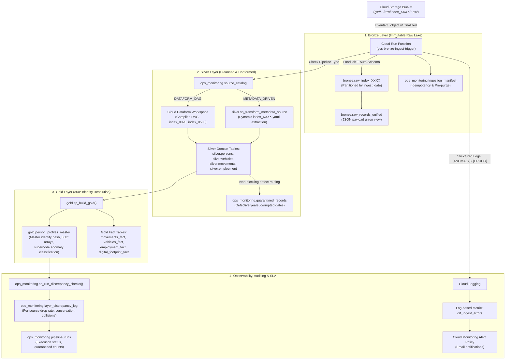

# Medallion Lakehouse Platform on Google Cloud (GCP)

Autonomous, event-driven Enterprise Medallion Data Platform (Bronze $\rightarrow$ Silver $\rightarrow$ Gold) deployed on Google Cloud Platform (`europe-west1`), powered by **BigQuery**, **Cloud Dataform**, **Eventarc**, and **Cloud Run Functions (2nd Gen)**.

---

## Architecture Overview



---

## Key Design Principles

1. **Autonomous "Drop CSV $\rightarrow$ Gold" Ingestion:**
   Investigators and data engineers simply drop any CSV file into `gs://<bucket>/raw/<source_id>/<filename>.csv`. The Eventarc trigger starts the entire Medallion cycle without requiring scheduled batch cron jobs or manual intervention.
2. **Generic Source Indexing (Zero Business Leaks):**
   Sources are identified strictly by normalized generic codes (`index_0001`, `index_0020`, `index_0500`), guaranteeing complete elimination of vendor or brand leaks in table names and schemas.
3. **Hybrid Silver Orchestration:**
   - **Complex Cross-Entity Sources:** Processed via **Dataform DAGs** (`index_0020` passenger transit, `index_0500` traffic police vehicle ownership) with automated compile-time dependency management and incremental watermarking.
   - **Entity-Centric Sources:** Processed dynamically via metadata-driven configuration YAMLs (`gcp_migration/metadata/sources/`).
4. **Fault-Tolerant Non-Blocking Data Validation:**
   Row-level data quality defects (e.g., negative years, corrupted dates, placeholder values) do **not** crash the pipeline. Clean data proceeds to Gold, while defective records are routed into `ops_monitoring.quarantined_records` with exact diagnosis reasons, logging `[ANOMALY]` and notifying the engineer via Cloud Monitoring.
5. **Deterministic Graph Identity Resolution:**
   Combines multi-factor anchors (Passport $\rightarrow$ INN $\rightarrow$ Phone $\rightarrow$ Name+DOB) into deterministic SHA-256 `person_id` master hashes, with automated supernode protection (`is_suspicious_cluster = TRUE`) to flag synthetic collisions without losing intelligence searchability.

---

## Directory Structure

```text
├── gcp_migration/              # Core GCP Medallion Platform Engine
│   ├── cloud_functions/        # Eventarc Cloud Run Function (gcs_ingest_trigger)
│   ├── dataform/               # Cloud Dataform project (staging & silver definitions)
│   ├── metadata/               # Source catalog specifications (index_XXXX.yaml) & sync tool
│   ├── sql/                    # BigQuery DDL, UDFs, Gold procedures & monitoring routines
│   ├── generator/              # High-fidelity synthetic dataset generator
│   └── ARCHITECTURE_AND_PLAN.md# Technical specification & operational runbook
├── datasets/                   # Reference schemas and historical templates
├── data/                       # Synthetic sample and benchmark CSV datasets
├── deploy.sh                   # Infrastructure provisioning script (GCS, BigQuery, IAM)
├── teardown.sh                 # Safe decommissioning & teardown script
└── generate_data.sh            # Helper script to generate synthetic test datasets
```

---

## Deployment & Operation

### 1. Initial Infrastructure Setup
To provision the GCS staging bucket, BigQuery datasets (`bronze`, `silver`, `gold`, `ops_monitoring`), persistent UDFs, and stored procedures:
```bash
./deploy.sh
```

### 2. Synchronize Source Catalog & Dataform
To register new source YAMLs and sync Dataform definitions to the GCP Dataform workspace:
```bash
python3 gcp_migration/metadata/sync_catalog.py
```

### 3. Deploy Eventarc Cloud Run Function
```bash
gcloud functions deploy gcs-bronze-ingest-trigger \
  --gen2 \
  --region=europe-west1 \
  --runtime=python311 \
  --source=./gcp_migration/cloud_functions/gcs_ingest_trigger \
  --entry-point=on_gcs_object_finalized \
  --service-account=medallion-pipeline@medallion-project-512608.iam.gserviceaccount.com \
  --memory=512Mi \
  --timeout=300s \
  --set-env-vars=PROJECT_ID=medallion-project-512608,LOCATION=europe-west1
```

### 4. Ingesting Data
Simply copy any CSV to the target source folder in Cloud Storage:
```bash
gcloud storage cp my_data.csv gs://medallion-project-512608-raw-data/raw/index_0500/my_data.csv
```
The pipeline automatically executes:
`GCS Upload` $\rightarrow$ `Bronze Ingest` $\rightarrow$ `Silver DAG / Extraction` $\rightarrow$ `Gold Resolution` $\rightarrow$ `Discrepancy Checks` $\rightarrow$ `Audit Run Log`.

---

## Monitoring & Audit Queries

### Pipeline Execution Runs
```sql
SELECT run_id, pipeline_name, ingest_date, started_at, completed_at, status, 
       total_bronze_rows, total_silver_rows, total_gold_rows, quarantined_rows, error_message
FROM `medallion-project-512608.ops_monitoring.pipeline_runs`
ORDER BY started_at DESC LIMIT 10;
```

### Layer Discrepancy & Reconciliation Log
```sql
SELECT source_id, check_name, status, expected_count, actual_count, discrepancy_count, details, check_timestamp
FROM `medallion-project-512608.ops_monitoring.layer_discrepancy_log`
WHERE ingest_date = CURRENT_DATE()
ORDER BY check_timestamp DESC;
```

### Quarantined Defective Records
```sql
SELECT quarantine_id, source_id, reason, raw_payload, created_at
FROM `medallion-project-512608.ops_monitoring.quarantined_records`
ORDER BY created_at DESC LIMIT 20;
```
