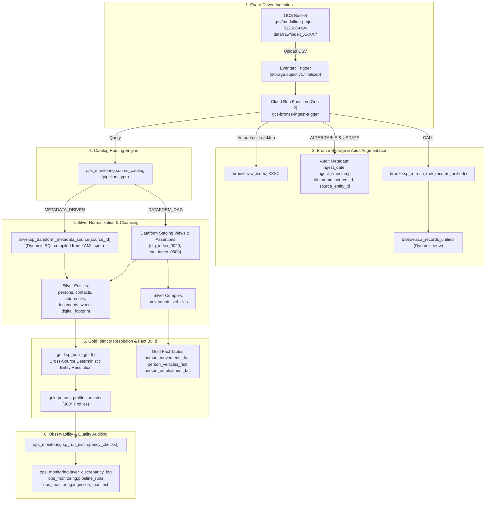

# GCP Medallion Architecture & Migration Plan

## 1. Executive Summary & Platform Context

Platform: **Google Cloud Platform (`medallion-project-512608`)**  
Location: **`europe-west1`**  
Architecture Pattern: **Hybrid Medallion Platform (Tier-1 Metadata-Driven Standard + Tier-2 Dataform DAG)**  
Core Purpose: **Scalable, zero-downtime OSINT entity extraction, normalization, and 360-degree identity resolution across 650+ heterogeneous leaks, registries, and CRM dumps.**



---

## 2. Architecture Evolution: Why the Hybrid Pattern?

### 2.1 The Friction of Monolithic Stored Procedures
Initially, source ingestion was consolidated into a single monolithic stored procedure (`silver.sp_transform_to_silver`) that executed hardcoded `UNION ALL` statements across all source tables.

**The Breaking Flaw:**  
BigQuery stored procedures perform static compile-time validation on procedure creation. If an engineer added a reference to a new source table (e.g. `bronze.raw_index_0042`) before that table was physically created in BigQuery, the procedure creation failed with:
```
Error validating procedure body: Query error: Not found: Table bronze.raw_index_0042 was not found in location europe-west1
```
This created a circular dependency requiring manual intervention for every new source.

### 2.2 The Hybrid Pattern (Tier-1 Standard + Tier-2 Dataform DAG)
To resolve this permanently and support 650+ sources:
1. **Tier-1 Metadata-Driven Standard (95% of sources):**  
   Standard sources require only column-to-entity mappings (names, phones, emails, addresses). These are defined in **declarative YAML files** and executed via **Dynamic SQL (`EXECUTE IMMEDIATE`)** that inspects `INFORMATION_SCHEMA.TABLES`. If a table does not exist yet, the engine outputs `[SKIP]` without failing!
2. **Tier-2 Dataform DAG (5% of complex sources):**  
   Sources requiring complex joins, temporal window checks, multi-leg travel itineraries, or strict data quality assertions are modeled as **Dataform SQLX DAGs** with compile-time assertions.

---

## 3. Source Classification (The 8 Benchmark Sources)

| Source ID | Source Name | Pipeline Type | Rationale & Processing Logic | Target Entities |
| :--- | :--- | :--- | :--- | :--- |
| **`index_0001`** | Retail Loyalty CRM (585 Zoloto) | **`METADATA_DRIVEN`** | Standard 1-to-1 customer CRM, pawnshop metrics, passport data. | `persons`, `contacts`, `addresses`, `documents` |
| **`index_0696`** | Microloans Registry (Dozarplati) | **`METADATA_DRIVEN`** | Direct microloan application records and employer relationships. | `persons`, `contacts`, `works`, `addresses` |
| **`index_0800`** | E-Commerce Perfume Store (DuhiRF) | **`METADATA_DRIVEN`** | Standard e-commerce orders, customer IDs, and phones. | `persons`, `contacts` |
| **`index_0801`** | B2B Client Registry (SKB Techno) | **`METADATA_DRIVEN`** | Legal company registrations, corporate INNs, and directors. | `persons`, `contacts`, `works` |
| **`index_0080`** | Gaming Platform Registrations | **`METADATA_DRIVEN`** | Digital footprint sessions, IP addresses, Telegram handles. | `persons`, `contacts`, `digital_footprint` |
| **`index_0042`** | Courier Delivery Service (Test Drop) | **`METADATA_DRIVEN`** | Online food delivery orders with customer IP, phone, and delivery address. | `persons`, `contacts`, `addresses`, `digital_footprint` |
| **`index_0020`** | Sirena Rail Passenger Itinerary | **`DATAFORM_DAG`** | **Multi-leg transit itinerary**, coach classes, seat reservations, and temporal assertions (`arrival_date >= departure_date`). | `movements`, `persons`, `documents`, `contacts` |
| **`index_0500`** | GIBDD SPb Traffic Police Registry | **`DATAFORM_DAG`** | **Dual corporate vs individual ownership resolution**, vehicle model cleanup, VIN/plate assertions (`manufacture_year >= 1950`). | `vehicles`, `persons`, `documents`, `contacts`, `works` |

---

## 4. Architectural Layers & Technical Components

### 4.1 Autonomous Eventarc Ingestion Trigger
- **Cloud Run Function (Gen 2):** `gcs-bronze-ingest-trigger` (`europe-west1`)
- **Trigger Event:** `google.cloud.storage.object.v1.finalized` on bucket `gs://medallion-project-512608-raw-data/raw/index_XXXX/*`
- **Execution Flow:**
  1. **Idempotent Manifest Lookup:** Checks `ops_monitoring.ingestion_manifest`. If the file was already ingested, preserves original `first_ingest_date` and increments `reupload_count`.
  2. **Purge on Reload:** If re-uploading, deletes existing rows for that file from `bronze.raw_index_XXXX` to guarantee zero duplicate records.
  3. **Bronze Load & Schema Autodetection:** Loads CSV via BigQuery `LoadJobConfig` (`autodetect=True` if table does not exist).
  4. **Metadata Augmentation:** Executes `ALTER TABLE` to add `ingest_date`, `ingest_timestamp`, `file_name`, `source_id`, `source_entity_id`, and backfills any nulls.
  5. **Dynamic Unified View Refresh:** Calls `bronze.sp_refresh_raw_records_unified()`.
  6. **Downstream Dispatch:** Queries `ops_monitoring.source_catalog`. Invokes `silver.sp_transform_metadata_source` (for metadata sources) or Dataform staged models.
  7. **Gold Resolution & Audit:** Runs `gold.sp_build_gold` and `ops_monitoring.sp_run_discrepancy_checks`.
  8. **Audit Log:** Records pipeline execution in `ops_monitoring.pipeline_runs` with status `SUCCESS`.

### 4.2 Metadata-Driven Dynamic Silver Engine
- Defined in [`gcp_migration/sql/06_dynamic_silver_engine.sql`](file:///Users/oleksandr_ukrainian/Projects/medallion-project/gcp_migration/sql/06_dynamic_silver_engine.sql).
- Stored Procedures:
  - `silver.sp_transform_metadata_source(p_source_id, p_ingest_date)`: Dynamically reads JSON spec from `ops_monitoring.source_catalog`, builds SQL `INSERT` statements with UDF cleaners, and populates `persons`, `contacts`, `addresses`, `documents`, `works`, and `digital_footprint`.
  - `silver.sp_transform_all_metadata_sources(p_ingest_date)`: Iterates over all active metadata sources dynamically.
  - `bronze.sp_refresh_raw_records_unified()`: Automatically queries `INFORMATION_SCHEMA.TABLES` for `raw_index_%` and rebuilds `bronze.raw_records_unified` using `TO_JSON_STRING(t)`.

### 4.3 Dataform DAG for Complex Pipelines
- Local Directory: [`gcp_migration/dataform/`](file:///Users/oleksandr_ukrainian/Projects/medallion-project/gcp_migration/dataform/)
- Cloud Repository: `projects/medallion-project-512608/locations/europe-west1/repositories/medallion-complex-pipelines`
- Staging Views & Assertions:
  - `stg_index_0020_movements.sqlx`: Asserts `uniqueKey`, `nonNull`, and `arrival_date >= departure_date`.
  - `stg_index_0500_vehicles.sqlx`: Asserts `uniqueKey`, `nonNull`, and `manufacture_year >= 1950`.
- Incremental Target Models:
  - `silver_movements_index_0020.sqlx`
  - `silver_vehicles_index_0500.sqlx`

### 4.4 Gold Layer Identity Resolution & Graph Consolidation
- Stored Procedure: [`gold.sp_build_gold(p_ingest_date)`](file:///Users/oleksandr_ukrainian/Projects/medallion-project/gcp_migration/sql/04_gold_tables_and_sp.sql).
- Core Table: `gold.person_profiles_master`
  - Aggregates identities across all Bronze/Silver sources using deterministic keys (full name + birthdate, clean phone, or passport).
  - Uses `ARRAY_AGG(... IGNORE NULLS)` to ensure clean array structures for phones, emails, addresses, documents, vehicles, and movements.
- Fact Tables:
  - `gold.person_movements_fact`
  - `gold.person_vehicles_fact`
  - `gold.person_employment_fact`
  - `gold.person_digital_footprint_fact`

---

## 5. CI/CD Quality Gates & Automation

1. **Dataform Compilation Quality Gate:**  
   [`.github/workflows/dataform_ci.yml`](file:///Users/oleksandr_ukrainian/Projects/medallion-project/.github/workflows/dataform_ci.yml)
   - Runs on PRs touching `gcp_migration/dataform/**`.
   - Executes `dataform compile` to guarantee 0 syntax errors and valid DAG action compilation.

2. **Source Catalog Validation & Auto-Sync:**  
   [`.github/workflows/metadata_sync.yml`](file:///Users/oleksandr_ukrainian/Projects/medallion-project/.github/workflows/metadata_sync.yml)
   - Runs on PRs touching `gcp_migration/metadata/**` or `cloud_functions/**`.
   - Validates all YAML files via [`validate_catalog.py`](file:///Users/oleksandr_ukrainian/Projects/medallion-project/gcp_migration/metadata/validate_catalog.py).
   - Runs unit tests via [`test_ingest.py`](file:///Users/oleksandr_ukrainian/Projects/medallion-project/gcp_migration/cloud_functions/gcs_ingest_trigger/test_ingest.py).
   - On push to `main`, synchronizes BigQuery `ops_monitoring.source_catalog` via [`sync_catalog.py`](file:///Users/oleksandr_ukrainian/Projects/medallion-project/gcp_migration/metadata/sync_catalog.py).

---

## 6. Operational Runbook: Adding New Sources

### Scenario 1: Standard Metadata Source (95% of cases — ~2 mins)
1. Create `gcp_migration/metadata/sources/index_XXXX.yaml`.
2. Validate and sync:
   ```bash
   python gcp_migration/metadata/validate_catalog.py
   python gcp_migration/metadata/sync_catalog.py
   ```
3. Drop the CSV file into `gs://medallion-project-512608-raw-data/raw/index_XXXX/data.csv`.
4. The system autonomously creates Bronze, extracts Silver, updates Gold, and logs audit metrics! Zero SQL editing required.

### Scenario 2: Complex DAG Source (Dataform)
1. Create `gcp_migration/metadata/sources/index_YYYY.yaml` with `pipeline_type: "DATAFORM_DAG"`.
2. Create staging view and assertions in `gcp_migration/dataform/definitions/staging/stg_index_YYYY.sqlx`.
3. Compile and verify locally:
   ```bash
   dataform compile gcp_migration/dataform
   ```
4. Wire staging view into `silver.sp_transform_to_silver` inside [`03_silver_tables_and_sp.sql`](file:///Users/oleksandr_ukrainian/Projects/medallion-project/gcp_migration/sql/03_silver_tables_and_sp.sql).

---

## 7. Lifecycle Scripts

- **`./generate_data.sh [--mode sample|full]`**: Generates statistically realistic synthetic CSV data across all 8 benchmark sources.
- **`./deploy.sh`**: Deploys BigQuery datasets, persistent UDFs, Bronze, Silver, Gold, Monitoring routines, Source Catalog, Scheduled Queries, and Cloud Run Functions.
- **`./run_pipeline.sh [--mode sample|full]`**: Uploads synthetic datasets to GCS, initiates autonomous Eventarc ingestion, verifies completion, and prints discrepancy audit summaries.
- **`./teardown.sh`**: Completely destroys all provisioned GCP assets (Cloud Run Functions, Scheduled Queries, Dataform Cloud Repositories, BigQuery Datasets, and GCS buckets) to guarantee zero lingering cost.
